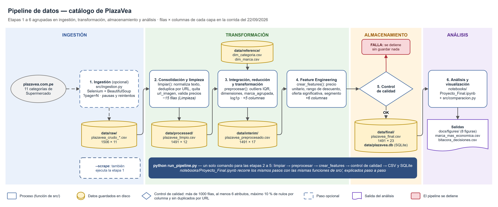

# Proyecto-ACD

Proyecto final del curso Análisis Computacional de Datos (DS3021). A partir del catálogo público
de [PlazaVea](https://www.plazavea.com.pe/), extraído con Selenium y BeautifulSoup, construye un
dataset de precios, descuentos y marcas para orientar decisiones de compra.

- **Parte I:** extracción, limpieza inicial y diccionario (`notebooks/Proyecto_.ipynb`).
- **Parte II:** preprocesamiento, ingeniería de características, análisis y pipeline
  (`notebooks/Proyecto_Final.ipynb` y `run_pipeline.py`).

La estructura completa del repositorio y los pasos para reproducirlo están en la sección
[Parte II](#parte-ii--preprocesamiento-features-y-análisis).

## Entorno virtual

```bash
python -m venv .venv
# Windows
.venv\Scripts\activate
# macOS/Linux
source .venv/bin/activate

pip install -r requirements.txt
```

Con el entorno activado, abrir los notebooks de `notebooks/` en Jupyter o VS Code. Usan rutas
relativas (`../data/...`), así que hay que ejecutarlos desde esa carpeta y no moverlos de ahí.

## Integrantes

- Denilson Jermai Cuadros Villegas 202510232
- Enrique Eusebio Torres Chafloque 202510601
- Leo Alexander Torres Ccencho 202410078
- Valeria Bazán Meléndez 202410443
- Lucas Armando Aliaga Mena 201810550

## Parte II — Preprocesamiento, features y análisis

El preprocesamiento, la ingeniería de características y el análisis de descuentos y ahorro
viven en **un solo notebook**, `notebooks/Proyecto_Final.ipynb`, en el orden en que se fue
trabajando — así se evita tener archivos sueltos y todo se lee de corrido. El código reutilizable
que ese notebook importa vive en `src/`, y es el mismo que usa `run_pipeline.py`, así que el
resultado de ambos coincide siempre:

```
Proyecto-ACD/
├── run_pipeline.py                        # pipeline completo: crudo -> final + SQLite
├── src/
│   ├── ingestion.py                       # extracción del catálogo, opcional (--scrape)
│   ├── preprocessing.py                   # limpieza y preprocesamiento
│   ├── features.py                        # ingeniería de características
│   └── comparacion.py                     # comparación entre marcas y tarjeta Oh!
├── notebooks/
│   ├── Proyecto_.ipynb                    # Parte I: scraping + limpieza inicial
│   └── Proyecto_Final.ipynb               # Parte II completa, en un solo archivo
├── data/
│   ├── raw/                               # crudo del scraping
│   ├── processed/                         # dataset limpio e inicial (Parte I)
│   ├── interim/                           # dataset preprocesado
│   ├── final/                             # dataset final, también lo regenera run_pipeline.py
│   ├── reference/                         # dim_categoria.csv, dim_marca.csv
│   └── plazavea.db                        # mismo dataset final, en SQLite
└── docs/
    ├── informe_parte1.pdf                 # informe de la Parte I
    ├── informe_parte2.pdf                 # informe de la Parte II
    ├── diccionario_datos_inicial.pdf      # diccionario del dataset inicial (12 variables)
    ├── diccionario_datos_final.pdf        # diccionario del dataset final (23 variables)
    ├── bitacora_decisiones.csv            # cada decisión técnica, con su justificación
    ├── cifras_oficiales.csv               # cifras que se citan en el informe
    ├── evidencia_vendedor.csv             # verificación manual de la marca GENÉRICO
    ├── marca_mas_economica.csv            # marca más barata por tipo de producto
    ├── pipeline.drawio                    # diagrama del pipeline (fuente editable en draw.io)
    ├── pipeline.png                       # el mismo diagrama exportado
    ├── presentacion_parte2.pptx           # diapositivas de la exposición final
    └── figures/                           # figuras del análisis (f3_* descuentos, f4_* marcas y Oh!)
```

### Flujo de datos



Cada proceso es una función de `src/` y deja una capa de datos en disco (`raw` → `processed` →
`interim` → `final`), así que cualquier etapa se puede revisar o repetir sin volver a extraer el
catálogo. Para editar el diagrama, abrir `docs/pipeline.drawio` en draw.io
([app.diagrams.net](https://app.diagrams.net) o la app de escritorio) y exportarlo de nuevo a
`docs/pipeline.png`.

### Reproducir el proyecto

```bash
pip install -r requirements.txt
jupyter nbconvert --to notebook --execute --inplace notebooks/Proyecto_Final.ipynb
# o, de forma equivalente y más rápida (sin abrir Jupyter):
python run_pipeline.py            # usa el crudo ya guardado en data/raw/
python run_pipeline.py --scrape   # antes, vuelve a extraer el catálogo (unos 24 minutos en la corrida del 22/09/2026)
```

Las dos vías llegan al mismo resultado porque comparten el código de `src/`: el notebook lo
explica paso a paso con gráficos e interpretación (para leer y para el informe); el pipeline lo
corre de punta a punta en segundos (para verificar reproducibilidad y regenerar
`data/plazavea.db`). `run_pipeline.py` verifica los requisitos de calidad de la rúbrica antes de
guardar.

### Comparación entre marcas y tarjeta Oh!

La última parte de `notebooks/Proyecto_Final.ipynb` responde los objetivos 5 y 6 del informe:

- **Objetivo 5 — marcas más económicas.** Se compara `precio_unitario_normalizado` dentro de
  grupos de productos similares (misma categoría, mismo tipo de producto y misma unidad de
  medida; al menos 4 productos y 2 marcas). La salida práctica es `docs/marca_mas_economica.csv`:
  una fila por grupo con la marca más barata (`marca_mas_economica`), si es marca propia de
  PlazaVea (`es_marca_propia`), la más cara (`marca_mas_cara`), cuánto se ahorra frente al precio
  típico del grupo (`ahorro_vs_mediana_pct`) y cuántas veces más cuesta la más cara
  (`veces_mas_cara`).
- **Objetivo 6 — tarjeta Oh!.** Tasa y participación de los precios exclusivos Oh! por categoría
  y macro_grupo, y su relación con las ofertas normales.

Las funciones están en `src/comparacion.py` y las figuras en `docs/figures/f4_*.png`. No cambia
el dataset final.
